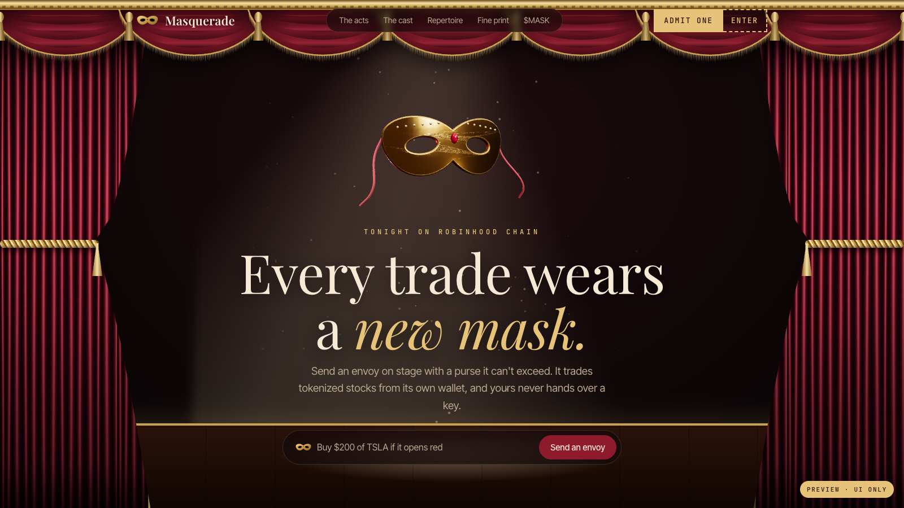

# Masquerade

**Purse-capped trading agents ("envoys") for tokenized stocks on Robinhood Chain.**

You fund an envoy with a purse, give it a list of stocks, a per-order cap, a daily buy limit, a max slippage and a curfew. An off-chain agent watches prices and trades for you, but every order goes through an on-chain vault that enforces those limits. The agent can never withdraw, never trade a stock off its list, and never spend more than the purse.

> **Status: prototype.** Everything runs on a local [anvil](https://book.getfoundry.sh/anvil/) chain with mock tokens, a mock router and a mock oracle. The contracts are **not audited** and **not deployed** anywhere. Don't put real money in this.



---

## What's in the repo

```
.
├── preview.html          Landing page ("Opera Stage" design, three.js mask, procedural curtains)
├── app.html              The app: Trade · Masks · Envoys · Bridge · Portfolio
├── ideas.html            The five design directions we compared (D was picked)
├── preview-gala.html     Earlier landing design, kept for reference
├── app-gala.html         Earlier app design, kept for reference
├── mask3d.js             three.js gold mask (hero + app)
├── js/
│   ├── stage.js          Procedural velvet curtains and swagged valance
│   ├── chain.js          viem client for the local chain (Envoys tab)
│   ├── envoys-live.js    Wires the Envoys tab to contracts + agent
│   └── abi.js            Generated ABIs (from contracts/out)
├── brand/                Logo, favicon, X profile picture
├── contracts/            Foundry project: EnvoyVault, EnvoyFactory, TWAP oracle  → contracts/README.md
├── agent/                Node agent: rule engine, runner, API, optional Claude  → agent/README.md
├── deployments/          Written by the deploy script (local.json), git-ignored
└── dev.sh                One command to run the whole local stack
```

### What's real and what's demo

| Part | State |
|---|---|
| Landing page | Done (UI) |
| App: **Envoys** tab | **Live** on the local chain: create envoy, manual buy/sell, recall, automatic rules |
| App: Trade, Masks, Bridge, Portfolio tabs | **Demo only** (fake prices, no chain calls) |
| Contracts (`EnvoyVault`, `EnvoyFactory`, `UniswapV3TwapOracle`) | Written + 33 tests passing; not audited, not deployed |
| Agent (rules, runner, API) | Working locally, 11 unit tests + an end-to-end test |
| Claude in the agent | Wired and unit-tested with a fake client; needs your own API key to run for real |

---

## Quick start

### 1. Install the tools

- **Node.js 20+** (`node -v`)
- **Foundry** (forge, anvil, cast): `curl -L https://foundry.paradigm.xyz | bash && foundryup`
- **Python 3** (only used as a static file server)

### 2. Clone and install

```bash
git clone https://github.com/Dhkrmynti/masquerade.git
cd masquerade
(cd agent && npm install)
(cd contracts && forge build)
```

OpenZeppelin and forge-std are vendored in `contracts/lib`, so there are no git submodules to fetch.

### 3. Run everything

```bash
./dev.sh
```

This starts anvil on `:8545`, deploys the contracts and mock tokens (writes `deployments/local.json`), starts the agent on `:5199` (log in `agent.log`), and serves the site on `:5198`.

Open:

- Landing: <http://127.0.0.1:5198/preview.html>
- App, Envoys tab: <http://127.0.0.1:5198/app.html#envoys>

anvil keeps its state in memory: every restart of `dev.sh` is a fresh chain. The agent notices the new chain and resets its own state.

### 4. Try an envoy

1. In the Envoys tab press **+ New envoy**, keep the defaults, and press **Fund & send envoy**.
2. Talk to it in the chat:
   - Manual: `buy $50 NVDA`, `buy $500 NVDA` (refused by the vault: over the cap), `sell all NVDA`, `recall`
   - Rules for the agent: `buy $50 NVDA if it drops 2%`, `sell half NVDA if it rises 5%`, `buy $25 SPY every 1 hour`
     (simple Indonesian works too: `beli $50 NVDA kalau turun 2%`)
3. Move a price to watch the agent act:
   ```bash
   node agent/scripts/move-price.js NVDA -3
   ```
   A 🤖 message appears in the chat when the agent trades.

The page uses anvil's built-in dev accounts (#0 = owner, #1 = agent) through the node's unlocked accounts, so no private key lives in the browser. These accounts are local-only.

---

## Tests

```bash
cd contracts && forge test     # 33 tests, incl. fuzzing (vault limits, oracle floor, TickMath)
cd agent && npm test           # 11 tests (rule parser/engine, Claude layer with a fake client)
cd agent && npm run e2e        # full flow on anvil (needs ./dev.sh running)
```

---

## Optional: Claude for free-form instructions

The agent understands fixed phrasings out of the box. With an Anthropic API key it also understands free text ("scoop up NVDA in small bites if it tanks") and asks back when something is ambiguous.

```bash
cp agent/.env.example agent/.env
# edit agent/.env and set ANTHROPIC_API_KEY=...
```

Restart the agent. The app shows **agent online · Claude**.

- `agent/.env` is git-ignored. **Never commit a key, and never paste one into an issue or chat.**
- Claude only translates instructions into a rule. Its output is validated by the same checks as the built-in parser, and the vault still enforces every limit on chain.
- Without a key, or if the API call fails, the agent falls back to the built-in parser.

---

## How it fits together

```
 user ──chat──► app.html ──rules──► agent (Node, :5199) ──swap()──► EnvoyVault (on chain)
                    │                    │   reads prices               ▲  enforces: purse, script,
                    │                    └──► oracle                    │  per-order cap, daily limit,
                    └──create / recall / manual trades (owner) ─────────┘  TWAP slippage floor, curfew
```

- **contracts/README.md**: the vault's limits, the oracle, and the threat model.
- **agent/README.md**: rule syntax, how the runner sizes and sends orders, and what's not production-ready.

## Before anything goes near mainnet

- [ ] A professional audit of the contracts
- [ ] Real Uniswap V3 router and factory addresses on Robinhood Chain (and confirm the stock tokens have V3 pools)
- [ ] Wallet connection (MetaMask or WalletConnect) instead of anvil dev accounts
- [ ] Owner-signed requests on the agent API (it has no auth today)
- [ ] An agent key held in a proper secret store, not an env var on a laptop
- [ ] Real implementations behind the Trade, Masks, Bridge and Portfolio tabs

## Honest note on "masks"

A fresh address funded from your main wallet **separates** positions but does **not** make them private: the funding transfer is public on chain. The landing page says this in "The fine print". Real privacy would need a shielded pool, which is out of scope here.

---

Not affiliated with Robinhood. Tokenized stocks are not shares. Not financial advice.
